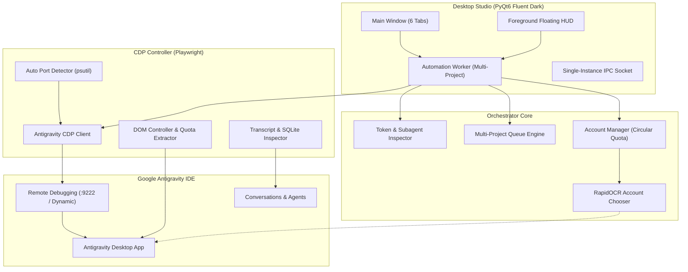

# Antigravity Orchestrator

<p align="center">
  
</p>

<p align="center">
  <strong>Enterprise-grade Desktop Automation Studio & Multi-Project Orchestrator for Google Antigravity</strong>
</p>

<p align="center">
  <a href="https://github.com/mohsinkhandevs/Antigravity-Orchestrator/actions/workflows/ci.yml"></a>
  <a href="https://github.com/mohsinkhandevs/Antigravity-Orchestrator/actions/workflows/release.yml"></a>
  <a href="https://github.com/mohsinkhandevs/Antigravity-Orchestrator/releases"></a>
  <a href="LICENSE"></a>
  <a href="https://www.python.org/"></a>
  <a href="https://riverbankcomputing.com/software/pyqt/"></a>
  <a href="https://playwright.dev/python/"></a>
  <a href="tests/"></a>
  
</p>

---

## Table of Contents

- [Overview](#overview)
- [Key Features](#key-features)
  - [Chrome DevTools Protocol (CDP) Engine](#chrome-devtools-protocol-cdp-engine)
  - [Circular Account Rotation & Smart Quota Manager](#circular-account-rotation--smart-quota-manager)
  - [Multi-Project Queue & Parallel Dispatch](#multi-project-queue--parallel-dispatch)
  - [Subagents & Chat Lifecycle Tracker](#subagents--chat-lifecycle-tracker)
  - [Token Generation Telemetry & Speed Metrics](#token-generation-telemetry--speed-metrics)
  - [Self-Healing Auto-Resume & Fail-Safe Hotkeys](#self-healing-auto-resume--fail-safe-hotkeys)
  - [Modern PyQt6 Studio & Always-On-Top Floating HUD](#modern-pyqt6-studio--always-on-top-floating-hud)
- [System Architecture](#system-architecture)
- [Directory Structure](#directory-structure)
- [Quick Start](#quick-start)
  - [Option A: Download Standalone Release (.exe)](#option-a-download-standalone-release-exe)
  - [Option B: Run from Source](#option-b-run-from-source)
- [Antigravity Setup & Remote Debugging](#antigravity-setup--remote-debugging)
- [Configuration](#configuration)
  - [Application Settings (`config.json`)](#application-settings-configjson)
  - [Accounts Setup (`accounts.json`)](#accounts-setup-accountsjson)
  - [Prompt Queue (`queue.json`)](#prompt-queue-queuejson)
- [Studio Interface Walkthrough](#studio-interface-walkthrough)
- [Testing](#testing)
- [Building from Source (PyInstaller)](#building-from-source-pyinstaller)
- [CI/CD & Automated Builds](#cicd--automated-builds)
- [Security, Privacy & Local-First Philosophy](#security-privacy--local-first-philosophy)
- [Contributing](#contributing)
- [License](#license)

---

## Overview

When developing and automating workflows inside [Google Antigravity](https://antigravity.google/), engineering workflows often require running long prompt pipelines across multiple workspaces while managing Gemini quota limits and session continuity.

**Antigravity Orchestrator** (Antigravity CDP Studio) provides a native, non-invasive companion studio:
- **Zero-Disruption Background Execution**: Directly communicates with the Antigravity desktop window through Chrome DevTools Protocol (CDP) without hijacking keyboard or mouse cursors.
- **Autonomous Account Rotation**: Automatically monitors Gemini 5-hour and weekly quotas. If an account runs low on quota, the orchestrator freezes it until reset and seamlessly switches to the next available account via browser OCR and OAuth automation.
- **Multi-Project Orchestration**: Dispatches tasks across multiple projects in parallel, tracking subagent trees, token speeds, and transcript completion.
- **Self-Healing Execution**: Continuously inspects session transcripts and SQLite database state to automatically resume stalled agents.

---

## Key Features

### Chrome DevTools Protocol (CDP) Engine
- **Automatic Port Discovery**: Uses `psutil` process inspection to detect running Antigravity instances and locate the active Chrome DevTools listening port dynamically without requiring manual configuration.
- **Direct DOM Interaction**: Locates chat input areas, project dropdowns, conversation controls, and model selectors directly using Playwright over CDP.
- **Non-Invasive Control**: Injects prompts and triggers actions natively via browser protocol, allowing you to use your computer normally while background tasks execute.

### Circular Account Rotation & Smart Quota Manager
- **Live Quota Telemetry**: Reads Gemini 5-hour and weekly quota percentages in real-time.
- **Intelligent Freezing**: When an account reaches low quota thresholds (e.g., `< 15%` 5-hour or `< 4%` weekly), the account is automatically frozen until its scheduled reset time (`weekly_reset_at`).
- **Autonomous OAuth Switching**: Powers automated sign-out and Google OAuth account selection using RapidOCR and DOM selector fallback.
- **Jump & Priority Routing**: Pin a specific account as the next switch target or manually trigger rotation on demand.
- **Pre-Switch Countdown HUD**: Displays a translucent countdown HUD prior to account rotation, allowing you to pause or adjust if desired.

### Multi-Project Queue & Parallel Dispatch
- **Workspace Isolation**: Organize prompt queues across multiple projects (`App-Core`, `Refocus`, `Antigravity Automation`, etc.).
- **Concurrent Dispatch**: Run up to `max_concurrent_projects` workers concurrently across separate project workspaces.
- **Queue Controls**: Reorder, duplicate, batch-import, clear completed prompts, pause/resume execution, or retry failed items.

### Subagents & Chat Lifecycle Tracker
- **Subagent Tree Explorer**: Real-time visibility into child subagents spawned by primary agents during complex coding workflows.
- **Role & Tool Tracking**: Inspect tool executions, subagent briefs, and operational statuses live in the Studio.
- **Conversation Session Inspector**: Correlates prompt execution with SQLite database session state and local transcript logs.

### Token Generation Telemetry & Speed Metrics
- **Speed Metering**: Calculates live token generation speed (**Tokens/Second**) during active model generation.
- **Token Analytics**: Breaks down token metrics per prompt: Input Tokens, Output Tokens, and Cache Read Tokens.
- **Time Profiling**: Measures exact time spent on model generation versus local tool execution.

### Self-Healing Auto-Resume & Fail-Safe Hotkeys
- **Transcript Stabilization**: Waits for completion indicators, thinking state conclusions, and network quiet periods before marking prompts complete.
- **Autonomous Follow-Ups**: Automatically dispatches configurable continuation mini-prompts (`"Please resume where you left off..."`) if an agent halts prematurely.
- **Emergency Kill Switch (`F10`)**: Instant hardware-level global hotkey to abort all active automation threads safely.
- **Floating HUD Toggle (`Ctrl+Shift+H`)**: Quick hotkey to show or hide the overlay HUD.

### Modern PyQt6 Studio & Always-On-Top Floating HUD
- **Fluent 2 / Linear Dark Theme**: Clean desktop studio featuring Dashboard, Queue, Accounts, Chats, Tokens, and Settings tabs.
- **Floating Foreground HUD**: Compact overlay showing active project, current account, remaining quota, and live prompt progress.
- **Single-Instance IPC**: Native local socket server ensures only one studio instance runs, automatically bringing the existing window to focus if relaunched.

---

## System Architecture



---

## Directory Structure

```
Antigravity-Orchestrator/
├── .github/
│   ├── ISSUE_TEMPLATE/             # Bug report & feature request templates
│   ├── workflows/
│   │   ├── ci.yml                  # CI pipeline: test suite + .exe artifact upload
│   │   └── release.yml             # Release pipeline: build standalone .exe & publish
│   └── PULL_REQUEST_TEMPLATE.md    # Pull request submission template
├── app/
│   ├── ui/                         # PyQt6 Studio UI tabs and widgets
│   │   ├── accounts_tab.py         # Google accounts management & quota table
│   │   ├── chats_tab.py            # Conversation lifecycle & transcript browser
│   │   ├── dashboard_tab.py        # System health, telemetry, and quick actions
│   │   ├── dialogs.py              # Error resolution and confirmation dialogs
│   │   ├── floating_hud.py         # Always-on-top floating HUD widget
│   │   ├── foreground_watcher.py   # Foreground window tracking
│   │   ├── main_window.py          # Primary window container & IPC handler
│   │   ├── project_hud.py          # Per-project overlay & countdown HUD
│   │   ├── queue_tab.py            # Multi-project prompt queue manager
│   │   ├── settings_tab.py         # Live configuration editor
│   │   ├── styles.py               # Dark theme stylesheet & UI tokens
│   │   ├── subagents_widget.py     # Live subagent hierarchy tree view
│   │   ├── tokens_tab.py           # Generation speed & token telemetry
│   │   └── widgets.py              # Shared custom UI widgets
│   ├── account_manager.py          # Circular queue & account freezing logic
│   ├── account_switcher.py         # Automated sign-out & OAuth workflow
│   ├── browser_ocr_automation.py   # RapidOCR account selection automation
│   ├── config.py                   # Dataclass configuration loader & validator
│   ├── hotkeys.py                  # Global hotkey registration (F10 / Ctrl+Shift+H)
│   ├── matcher.py                  # Window and UI element matching
│   ├── models.py                   # Data models (PromptItem, TaskStatus, etc.)
│   ├── power_manager.py            # System sleep prevention during execution
│   ├── quota_checker.py            # Quota threshold evaluations
│   └── worker.py                   # Execution engine & prompt consumer
├── assets/                         # Icons, UI icons, and button graphics
├── cdp/
│   ├── browser_oauth.py            # Profile popup and sign-out automation
│   ├── chat_lifecycle_inspector.py # Chat start/stop event inspector
│   ├── client.py                   # Dynamic port discovery and Playwright CDP client
│   ├── conversation_db_inspector.py# SQLite conversation database parser
│   ├── dom_controller.py           # DOM injection and project selection
│   ├── quota_inspector.py          # Quota percentage extraction from DOM
│   ├── reconciliation.py           # Prompt status reconciliation
│   ├── state_manager.py            # Antigravity UI state machine
│   ├── subagent_inspector.py       # Real-time subagent inspection
│   └── transcript_inspector.py     # Transcript JSONL monitor
├── tests/                          # 280+ automated unit & integration tests
├── accounts.example.json           # Template accounts file
├── build_exe.py                    # PyInstaller standalone packager
├── check_active_agents.py          # CLI agent inspector utility
├── config.example.json             # Template configuration file
├── CONTRIBUTING.md                 # Contribution guidelines
├── launch-antigravity.bat          # Launcher with remote debugging flag
├── LICENSE                         # MIT License
├── main.py                         # Application entry point
├── pytest.ini                      # Pytest configuration
├── queue.example.json              # Template prompt queue file
├── README.md                       # Documentation
├── requirements.txt                # Python dependencies
├── SECURITY.md                     # Security policy & disclosure
├── start-app.bat                   # Desktop launch script
└── start-automation.vbs            # Background launcher script
```

---

## Quick Start

### Option A: Download Standalone Release (.exe)

For users who want to run the studio without configuring a Python environment:

1. Go to the [Releases](https://github.com/mohsinkhandevs/Antigravity-Orchestrator/releases) page.
2. Download the latest `Antigravity_CDP_Studio.exe`.
3. Place `config.example.json` as `config.json` and `accounts.example.json` as `accounts.json` in the same directory.
4. Launch Antigravity with `--remote-debugging-port=9222` (see below) and double-click `Antigravity_CDP_Studio.exe`.

### Option B: Run from Source

#### 1. Prerequisites
- Windows 10 or 11 (64-bit)
- Python 3.10+ installed and on `PATH`
- Google Antigravity installed

#### 2. Clone & Setup Environment
```bash
git clone https://github.com/mohsinkhandevs/Antigravity-Orchestrator.git
cd Antigravity-Orchestrator

# Create virtual environment
python -m venv .venv
.\.venv\Scripts\Activate.ps1

# Install dependencies
pip install -r requirements.txt
playwright install chromium
```

#### 3. Initialize Configuration
```bash
copy config.example.json config.json
copy accounts.example.json accounts.json
```

#### 4. Launch Studio
```bash
python main.py
```
*(Or double-click `start-app.bat`)*

---

## Antigravity Setup & Remote Debugging

Antigravity Orchestrator connects to Google Antigravity through its Chrome DevTools Protocol (CDP) port.

### Launch with Remote Debugging
Before launching the Orchestrator, start Antigravity with the `--remote-debugging-port` flag:

**Using the included batch script:**
```cmd
launch-antigravity.bat
```

**Or manually via command line:**
```cmd
"%LOCALAPPDATA%\Programs\antigravity\Antigravity.exe" --remote-debugging-port=9222
```

> [!TIP]
> Antigravity Orchestrator features **Auto Port Discovery**. If Antigravity was started on a different debugging port, the orchestrator automatically detects the active port from running processes.

---

## Configuration

### Application Settings (`config.json`)

Configure operational parameters in `config.json`:

```json
{
    "window_title": "Antigravity",
    "cdp_port": 9222,
    "target_project_name": "No Project",
    "completion_stabilization_seconds": 3,
    "generation_timeout": 3600,
    "infinite_generation_timeout": true,
    "emergency_hotkey": "F10",
    "hud_hotkey": "Ctrl+Shift+H",
    "check_quota_before_queue": true,
    "check_quota_each_prompt": true,
    "pause_if_quota_low": true,
    "min_gemini_five_hour_quota": 15,
    "min_gemini_weekly_quota": 4,
    "low_quota_action": "change_account",
    "auto_switch_on_low_quota": true,
    "auto_launch_antigravity": true,
    "quota_retry_interval_seconds": 60,
    "quota_buffer_seconds": 60,
    "enable_auto_resume_same_chat": true,
    "resume_mini_prompt": "Please resume where you left off and finish the remaining work.",
    "max_resumes_per_prompt": 2,
    "quota_cache_seconds": 60,
    "known_projects": ["No Project"],
    "max_concurrent_projects": 3,
    "polling_interval_seconds": 2,
    "enable_independent_project_resume": true,
    "enable_foreground_hud": true,
    "enable_pre_switch_hud": true,
    "pre_switch_countdown_seconds": 30
}
```

| Parameter | Type | Default | Description |
|:---|:---:|:---:|:---|
| `cdp_port` | `int` | `9222` | Default CDP port if automatic port discovery is not used. |
| `min_gemini_five_hour_quota` | `int` | `15` | Minimum 5-hour quota percentage before rotating accounts. |
| `min_gemini_weekly_quota` | `int` | `4` | Minimum weekly quota percentage before freezing account. |
| `auto_switch_on_low_quota` | `bool` | `true` | Automatically rotate to next account when quotas drop below minimums. |
| `enable_auto_resume_same_chat` | `bool` | `true` | Automatically sends follow-up prompt if generation stops prematurely. |
| `resume_mini_prompt` | `string` | `...` | Follow-up prompt text sent to resume an interrupted agent. |
| `max_concurrent_projects` | `int` | `3` | Maximum number of concurrent project runners executing simultaneously. |
| `emergency_hotkey` | `string` | `"F10"` | Global hotkey to immediately halt all active automation workers. |
| `hud_hotkey` | `string` | `"Ctrl+Shift+H"` | Global hotkey to toggle always-on-top HUD visibility. |
| `enable_pre_switch_hud` | `bool` | `true` | Displays a translucent countdown overlay before switching accounts. |
| `pre_switch_countdown_seconds` | `int` | `30` | Duration of the pre-switch warning overlay in seconds. |

### Accounts Setup (`accounts.json`)

Define your circular account pool in `accounts.json`:

```json
[
  {
    "email": "developer1@example.com",
    "display_name": "Primary Developer",
    "id": "acc01",
    "enabled": true,
    "quota_status": "Ready",
    "weekly_percent": 100,
    "is_frozen": false
  },
  {
    "email": "developer2@example.com",
    "display_name": "Secondary Developer",
    "id": "acc02",
    "enabled": true,
    "quota_status": "Ready",
    "weekly_percent": 100,
    "is_frozen": false
  }
]
```

### Prompt Queue (`queue.json`)

Tasks can be defined directly through the Studio UI or pre-populated in `queue.json`:

```json
[
  {
    "id": "task01",
    "name": "Audit codebase architecture",
    "text": "Inspect the project structure, locate core entry points, and generate an architectural summary.",
    "project": "MyProject",
    "queue_name": "Default",
    "sequence": 0,
    "status": "Pending"
  }
]
```

---

## Studio Interface Walkthrough

```
┌────────────────────────────────────────────────────────────────────────┐
│  Antigravity CDP Studio                                       [ _ ][ X ]│
├────────────────────────────────────────────────────────────────────────┤
│ [ Dashboard ] [ Queue ] [ Accounts ] [ Chats ] [ Tokens ] [ Settings ] │
├────────────────────────────────────────────────────────────────────────┤
│                                                                        │
│  Connection Status: CONNECTED (Port 9222)   Active Project: MyProject  │
│  Worker State: RUNNING                      Account: user1@example.com │
│                                                                        │
│  5-Hour Quota:  [████████████████████      ] 78% (Resets in 3h 12m)   │
│  Weekly Quota:  [████████████████████████  ] 92% (Resets in 5d 14h)   │
│  Token Speed:   82.4 tokens/sec            Subagents Active: 2        │
│                                                                        │
│  [ ▶ Start Automation ]  [ ⏸ Pause ]  [ ⏹ Emergency Stop (F10) ]      │
└────────────────────────────────────────────────────────────────────────┘
```

1. **Dashboard Tab**: Central telemetry hub showing engine connection state, active account quota gauges, live execution logs, and quick playback controls.
2. **Queue Tab**: Multi-project prompt queue manager. Add, edit, duplicate, re-order, batch-clear, or filter prompts by workspace.
3. **Accounts Tab**: Circular rotation manager. View real-time quota status, freeze timers, manual rotation triggers, and account jumping.
4. **Chats Tab**: Inspect active conversation threads, model selections, SQLite session state, and raw conversation IDs.
5. **Tokens Tab**: Real-time generation velocity analytics (**tokens/second**), token consumption breakdown, and tool execution vs. generation time distributions.
6. **Settings Tab**: Graphical editor for quota limits, timeouts, concurrent project limits, and hotkeys.

---

## Testing

Antigravity Orchestrator features an automated test suite containing **282 tests** covering the entire system:
- CDP connection and DOM manipulation
- Circular queue logic, account freezing, and auto-unfreezing
- RapidOCR email detection and browser disambiguation
- SQLite conversation database inspection
- Subagent discovery and token speed analytics
- PyQt6 UI tabs and hotkey event dispatchers

Run the complete test suite:
```bash
python -m pytest
```

Run with coverage reporting:
```bash
python -m pytest --cov=app --cov=cdp
```

---

## Building from Source (PyInstaller)

To compile a standalone Windows executable (`.exe`):

```bash
# Build standalone single executable
python build_exe.py --onefile

# Build directory bundle (faster startup during development)
python build_exe.py --onedir
```

The generated executable will be placed in `dist/Antigravity_CDP_Studio.exe`.

---

## CI/CD & Automated Builds

This repository is equipped with fully automated GitHub Actions workflows:

### 1. Continuous Integration (`ci.yml`)
- Triggers on every `push` and `pull_request` to `main`.
- Runs on `windows-latest`.
- Installs dependencies and runs the entire 282-test test suite.
- Builds `Antigravity_CDP_Studio.exe` using PyInstaller.
- Computes SHA256 checksums and uploads the executable as a downloadable workflow artifact.

### 2. Release Pipeline (`release.yml`)
- Triggers on version tag pushes (`v*.*.*`) or manual `workflow_dispatch`.
- Verifies the test suite and builds the standalone single-file `.exe`.
- Publishes a **GitHub Release** with `Antigravity_CDP_Studio.exe` and `checksum-sha256.txt` attached as release assets.

---

## Security, Privacy & Local-First Philosophy

- **Zero Credential Capture**: Antigravity Orchestrator never captures, requests, or stores Google account passwords. Account rotation utilizes the native browser session and Google OAuth chooser.
- **Local-Only Communication**: All CDP commands and internal IPC occur strictly on local loopback (`127.0.0.1`).
- **No Data Leakage**: Sensitive files (`accounts.json`, `config.json`, `queue.json`) and runtime logs are strictly git-ignored.
- **Fail-Safe Hardware Stop**: The global `F10` hotkey instantly halts all automation threads.

For details or vulnerability reporting, see [SECURITY.md](SECURITY.md).

---

## Contributing

We welcome community contributions, bug reports, and suggestions!
Please read our [CONTRIBUTING.md](CONTRIBUTING.md) guide for details on repository guidelines, branch naming, and submitting pull requests.

---

## License

This project is licensed under the MIT License — see the [LICENSE](LICENSE) file for details.
